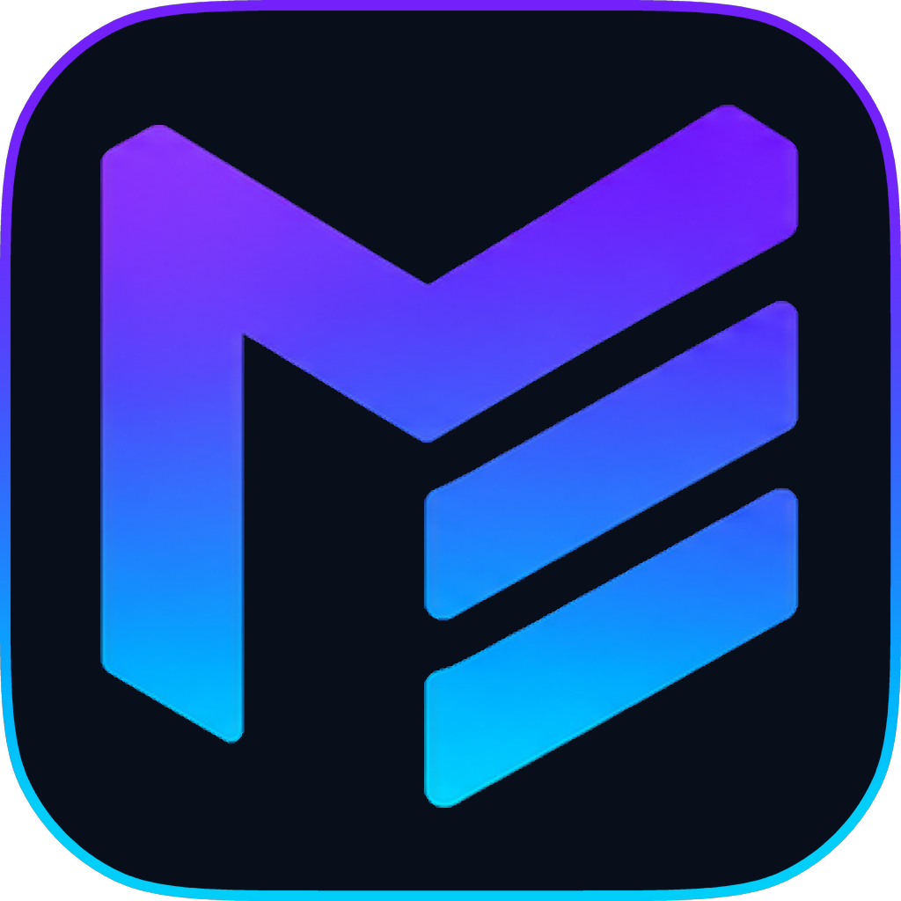

<p align="center">
  
</p>

<h1 align="center">ModShelf</h1>

<p align="center">
  Steam Workshop downloader for iOS
</p>

<p align="center">
  <a href="https://github.com/shplash/ModShelf/stargazers">
    
  </a>

  <a href="https://raw.githubusercontent.com/shplash/shplash-repo/main/apps.json">
    
  </a>

  <br>

  <a href="https://github.com/shplash/ModShelf/releases/latest">
    
  </a>

  <a href="https://github.com/shplash/ModShelf/releases/download/v1.0/ModShelf-v1.0.ipa">
    
  </a>

  <br>

  <a href="https://github.com/shplash/ModShelf/issues">
    
  </a>
</p>

<p align="center">
If you found ModShelf useful, a GitHub star is always appreciated.
</p>

## Features

- Sign in to Steam and keep the session between launches
- Paste a Workshop link, or browse the Workshop in the built-in browser
- Downloads sorted into a folder per game inside ModShelf's storage
- Library with search, tags, game filter, favourites and bulk select
- Update checks, file verification and ZIP export

## Install

1. Open the [latest release](https://github.com/shplash/ModShelf/releases/latest) and download the IPA.
2. Install it with a sideloading tool that signs for your device.

Use:
- SideStore
- AltStore
- Feather
- LiveContainer
- TrollStore
- etc

## Requirements

- iOS 16 or newer
- A Steam account and the game in your Steam library: Steam only hands over a game's Workshop items when your account holds its license. Free-to-play games give you that license when you add them to your library once.


## Where mods go

ModShelf organises downloads into a separate folder for each game.

Use the **open directory** button in ModShelf > Options > Downloads to jump straight to your downloads folder, regardless of how the app was installed.

Your downloads are organised like this:

```
Downloaded Mods/<game name>/<mod>
```


## Notes & Licensing

Steam and the Steam Workshop are trademarks of Valve Corporation. ModShelf is not made by or endorsed by Valve.

ModShelf is licensed under [GPL-3.0](LICENSE).

It bundles [go-steam](https://github.com/BirknerAlex/go-steam) by Alexander Birkner and [ZIPFoundation](https://github.com/weichsel/ZIPFoundation) by Thomas Zoechling, both [MIT](https://opensource.org/license/mit) licensed.

Third-party notices and the full licence texts are in [THIRD_PARTY_NOTICES.md](THIRD_PARTY_NOTICES.md).

## <a href="https://ko-fi.com/shplash"></a>

If ModShelf has been useful to you, you can support its development as well as future projects.
